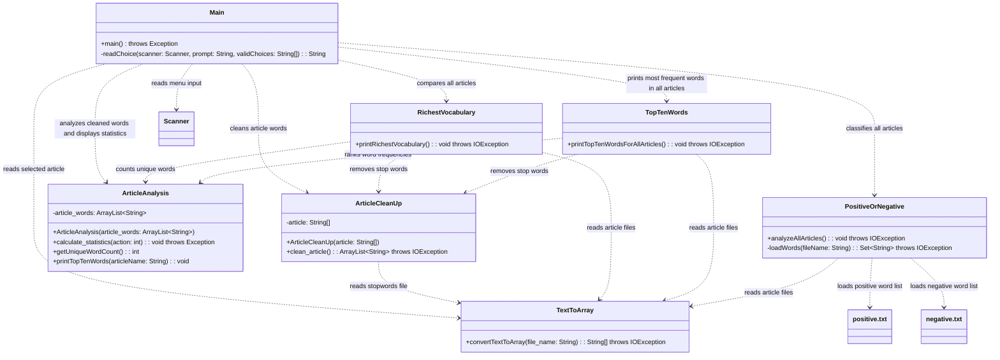

Project Description:

This project analyzes an article after removing stop words. It reports the total and unique word counts and ranks word frequencies. Words are lowercased before stop-word removal and analysis.

Opening the program runs the Main class. When you run it, press 1 for stats on one article and 2 for stats on all articles. Pressing 2 opens a second menu where you can press 1 for the richest vocabulary, 2 for the ten most frequent words in each article, 3 for positive or negative classification, or 4 to run all three. Choose. Multi-article options analyze the files in src/articles, excluding stopwords.txt in the analysis. Pressing 3 for positive/negative testing subtracts negative-word matches from positive-word matches, and the results are shown. The word lists in src/positiveornegative are lists of basic positive and negative vocabulary.

Milestone 1 screenshots:

Milestone 2 screenshots:

Work Completed by Each Group Member

John: Uploaded/found articles, wrote comments, created readme.

Louis: Programmed the main classes.

Milestone 2:

Louis: added the new classes and functionality, such as RichestVocabulary, PositiveOrNegative, and TopTenWords.

John:
