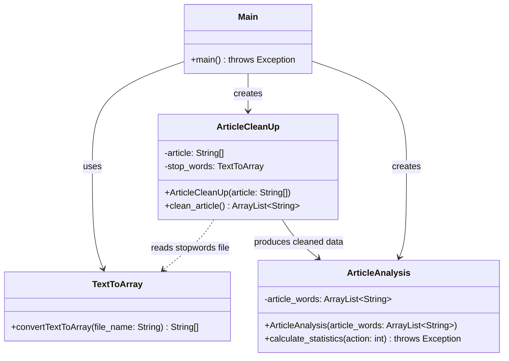

Project Description:

This project analyzes a given article and removes a set of stop words and prints the number of words, the number of unique words, and the words that appear most frequently and how often they appear. To use this program please run the main class and enter the name of your desired article (.txt) into the console. You will be directed then with clearly enumerated choices.

Test Screenshots:

Work Completed by Each Group Member

John: Uploaded/found articles, wrote comments, created readme.

Louis: Programmed the main classes.
